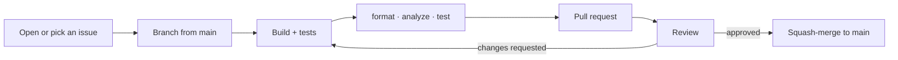

# Contributing to Clarion

Thanks for helping make commerce calmer. This guide covers setup, the quality bar, and the design rules that keep Clarion feeling like one deliberate object.

> [!NOTE]
> By participating you agree to the [Code of Conduct](CODE_OF_CONDUCT.md). Security issues go through [SECURITY.md](SECURITY.md) — never a public issue.

## Setup

| Requirement | Version |
| :--- | :--- |
| Flutter | stable channel (developed on 3.47) |
| Dart | ≥ 3.13 |
| IDE | Android Studio or VS Code with Flutter & Dart plugins |

```bash
git clone https://github.com/KrishKamra/Clarion.git
cd Clarion
flutter pub get
flutter run
```

Fonts are bundled in `assets/fonts/`; no network access is needed at runtime.

## Workflow



1. For anything beyond a small fix, open an issue first so the approach can be agreed.
2. Branch from `main`: `feat/…`, `fix/…`, `docs/…`, `refactor/…`, `test/…`.
3. Commit using [Conventional Commits](https://www.conventionalcommits.org/) — e.g. `feat(cart): show spec parity on swaps`.
4. Keep PRs focused; one concern per PR.

## Quality gates

All three must be clean before review:

```bash
dart format lib test        # formatting
flutter analyze             # zero issues (flutter_lints)
flutter test                # all tests pass, no layout overflows
```

> [!TIP]
> Widget tests render with Flutter's wide test font, so they surface overflows that real devices hide. If a test reports a `RenderFlex overflowed`, fix the layout (`Flexible`, ellipsis, `FittedBox`) rather than the test.

Add or update tests for any change to business rules — budget arithmetic, intent ranking, compare scoring, swap suggestions — and keep fit factors summing exactly to each product's score (a test enforces it).

## Design-system rules

These are non-negotiable; they're what keeps the interface quiet. Full reference: [docs/DESIGN_SYSTEM.md](docs/DESIGN_SYSTEM.md).

> [!IMPORTANT]
> - **Tokens only.** No raw hex colours, font sizes or durations in feature code — use `AppColors`, `AppTypography`, `AppSpacing`, `AppRadii`, `AppMotion`.
> - **Blur only on fixed chrome.** `BackdropFilter` lives solely inside `FrostedChrome`. Anything in a scroll view is a `TactileCard`.
> - **Glow is a gradient.** Use `AppDecorations.backlight`, never `MaskFilter.blur` or coloured drop shadows.
> - **Numbers are mono.** Prices, scores, deltas and counts use the `metric*` styles.
> - **One meaning per accent.** Iris = act, emerald = fits, amber = trade-off, rose = friction.
> - **Motion stays in 220–280 ms** on cubic curves. No elastic or bouncy curves.

> [!CAUTION]
> Clarion's voice is part of the product. Don't add urgency patterns — countdown deals, "only N left", pre-checked upsells, or confirm-shaming copy. Friction should protect the user, never pressure them.

## Code style

- Feature-first: shared code in `lib/core/`, feature state in `features/<name>/application/`, UI in `presentation/` or `widgets/`.
- Business rules belong in providers, not widgets. Read products through `catalogProvider`.
- Prefer small composable widgets; split a file once it passes ~250 lines.
- Comment the *why*, not the *what*; match the density of surrounding code.

## Pull request checklist

- [ ] `dart format lib test`, `flutter analyze` and `flutter test` are clean. CI runs the same checks and fails the build on any of them; formatting is the most common miss, so turn on format-on-save in your IDE
- [ ] Tests added or updated for behaviour changes
- [ ] Screenshots or a short recording for UI changes (phone width, light and dark)
- [ ] Design-system rules above respected
- [ ] `CHANGELOG.md` updated under **[Unreleased]**
- [ ] Docs updated if architecture or tokens changed

## Credit

Everyone who builds Clarion is listed in [`AUTHORS.md`](AUTHORS.md). In your first pull request, add a row with your name, GitHub handle and what you worked on, and update it as your contributions grow.

## Licensing

Contributions are accepted under the project's [MIT License](LICENSE), and contributors share its copyright (see [`AUTHORS.md`](AUTHORS.md)). Bundled fonts remain under the SIL Open Font License 1.1.
