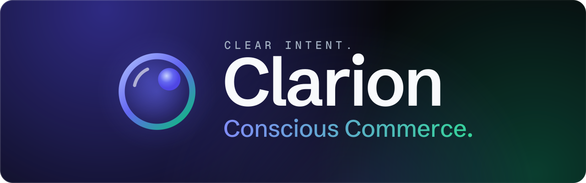
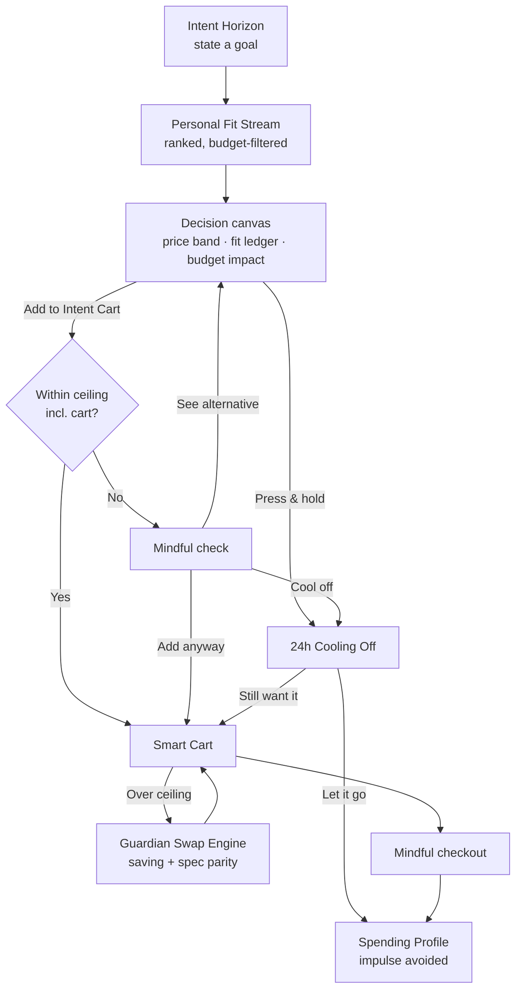

<p align="center">
  
</p>

<p align="center">
  <a href="https://flutter.dev"></a>
  <a href="https://dart.dev"></a>
  <a href="https://riverpod.dev"></a>
  <a href="https://firebase.google.com/docs/auth"></a>
  <a href="https://pub.dev/packages/sqflite"></a>
  <a href="https://m3.material.io"></a>
  
  <a href="LICENSE"></a>
</p>

Clarion is an intent-driven e-commerce **decision-support system** — *e-commerce that helps you buy better, not buy more.* Instead of infinite feeds and opaque recommendations, you state a goal, see exactly why each product fits (or doesn't), compare only what differs, and stay inside a monthly envelope that the app guards for you.

> [!NOTE]
> Products come from a mock catalogue and checkout is simulated. Sign-in is real (Firebase Authentication), and each account's cart, cooling-off holds, budget and watchlist are saved on the device in SQLite. See [Roadmap](#️-roadmap).

---

## 🎯 Feature pillars

| Pillar | What it does |
| :--- | :--- |
| 🔍 **Intent-first search** | Describe a goal (*"College Setup < ₹2.5k"*). An on-device parser extracts a price ceiling and keywords, then re-ranks the **Personal Fit Stream**. |
| 📊 **Explainable fit scores** | Every 0–100 score is a ledger — `+35` Intent Match, `−08` Weight Delta — that sums exactly to the score. |
| ⚖️ **Differential compare** | Head-to-head that hides identical specs, marks each criterion's winner, and lets you star priorities that count double. |
| 🛡️ **Budget Guardian** | A live barometer of settled spend + cart against your ceiling, with verified, cheaper swaps (and their spec parity) when you go over. |
| ⏳ **Anti-impulse friction** | A press-and-hold **24h Cooling Off**, a mindful check before over-ceiling adds, and price memory that informs without urgency. |

## 🧭 How a decision flows



## 📱 Screens

| Tab / route | File | Highlights |
| :--- | :--- | :--- |
| **Shell** | `features/navigation/main_scaffold.dart` | Frosted spatial capsule with a magnetic, haloed active pill; cart badge tinted by budget state; status dot while something is cooling off. |
| **Intent Horizon** | `features/home/presentation/intent_home_screen.dart` | Monogram, live `₹3,200 / ₹5,000` indicator with miniature gauge, profile node, conversational intent field with curated pills, horizontal **Personal Fit Stream** (gauge, rationale, top two weighted factors), **Price Memory Radar**. |
| **Decision canvas** *(pushed)* | `features/decision/presentation/product_decision_screen.dart` | Media stage with "Pickup in 1.8 km", scrubbable 30-day price band, "Why We Recommend This" ledger (`+35` / `+25` / `−08` … `= 94`), specs behind progressive disclosure, sticky bar: *"Leaves ₹801 safe buffer in your monthly limit"*, **Add to Intent Cart** vs press-and-hold **24h Cooling Off** with micro-progress timer. |
| **Compare Matrix** | `features/decision/presentation/compare_matrix_screen.dart` | Sticky A-vs-B header that collapses as you scroll, starred priorities (Price · Weight · Battery), weighted verdict, differences-only spec rows with per-row winners. |
| **Smart Cart (Guardian)** | `features/cart/presentation/smart_cart_screen.dart` | Interactive Spending Barometer (Safe → Caution → Over zones, touch a segment to see what it adds), Guardian Swap Engine, intent-priority pills, swipe-to-remove with undo, mindful checkout. |
| **Spending Profile** | `features/profile/presentation/spending_profile_screen.dart` | Backlit envelope ring, editable ceiling, cooling-off queue, mindful wins, six-month trend, category breakdown. |

## 🎨 Design language

*Obsidian Titanium & Botanical Emerald* — a matte `#07080B` canvas with film grain, two surface tiers lit by a directional specular rim, and four accents that each carry exactly one meaning. Type pairs **Schibsted Grotesk** (reading) with **Geist Mono** (prices, scores, labels), both bundled.

> [!TIP]
> The full token reference, material tiers and component catalogue are in [`docs/DESIGN_SYSTEM.md`](docs/DESIGN_SYSTEM.md).

## 🛠️ Tech stack

| Component | Technology |
| :--- | :--- |
| Framework | [Flutter](https://flutter.dev) 3.x · Material 3 · Dart 3 |
| State | [`flutter_riverpod`](https://pub.dev/packages/flutter_riverpod) 3.x — `Notifier`s + derived `Provider`s |
| Data | Mock catalogue behind `catalogProvider`; per-account local persistence in SQLite ([`sqflite`](https://pub.dev/packages/sqflite)) |
| Auth | [Firebase Authentication](https://firebase.google.com/docs/auth): email/password and Google ([`google_sign_in`](https://pub.dev/packages/google_sign_in)) |
| Brand | SVG logo and banner in `assets/brand/`, rendered with [`flutter_svg`](https://pub.dev/packages/flutter_svg) |
| Typography | Schibsted Grotesk + Geist Mono (OFL-1.1, bundled) |

## 🗂️ Project structure

```text
lib/
├── core/
│   ├── db/            # SQLite schema, repositories, per-account session loading
│   ├── theme/         # app_colors · app_typography · app_decorations · app_spacing · app_theme
│   ├── utils/         # INR (Indian grouping), signed weights, dates, countdowns
│   └── widgets/       # tactile_card · fit_score_gauge · intent_field · dynamic_pill ·
│                      # floating_nav_capsule · hold_button · price_band_chart · frosted_chrome …
├── data/
│   ├── models/        # product_model · cart_item_model · trade_off_item
│   ├── catalog.dart   # Read-only Catalog + catalogProvider (the backend seam)
│   └── mock_catalog.dart
├── features/
│   ├── auth/          # Firebase sign-in (email/password, Google) · sign-in screen
│   ├── home/          # Intent parsing & ranking · Intent Horizon (fit stream, price radar)
│   ├── decision/      # Decision canvas · Compare Matrix · cooldowns · compare scoring
│   ├── cart/          # Cart + budget state, Guardian Swap Engine · Smart Cart
│   ├── profile/       # Spending Profile (envelope, cooling-off queue, history)
│   └── navigation/    # AppTab controller & MainScaffold shell
└── main.dart          # Firebase init, AuthGate (per-account scopes), MaterialApp
```

Architecture, state graph and performance rules: [`docs/ARCHITECTURE.md`](docs/ARCHITECTURE.md).

## 🚀 Getting started

**Prerequisites:** [Flutter SDK](https://docs.flutter.dev/get-started/install) (stable, Dart ≥ 3.13) and an Android emulator/device or Chrome.

```bash
git clone https://github.com/KrishKamra/Clarion.git
cd Clarion
flutter pub get
flutter run
```

> [!NOTE]
> Sign-in uses Firebase Authentication and the project config is committed, so email sign-in works out of the box. To use Google sign-in on Android, register your debug key once: see [`docs/FIREBASE_SETUP.md`](docs/FIREBASE_SETUP.md).

### Quality checks

```bash
dart format lib test   # formatting
flutter analyze        # static analysis (flutter_lints) — expected: no issues
flutter test           # unit + widget tests — fails on any layout overflow
```

> [!IMPORTANT]
> Clarion is portrait-locked. It follows the system light/dark setting by default; Spending Profile → Appearance pins Light or Dark.

## 🧪 Demo scenario (seed data)

The mock state is tuned so the headline numbers fall out of real arithmetic:

- **Ceiling** ₹5,000 · **settled** ₹2,000 · **cart** ₹1,200 (desk lamp + cable kit) → header reads **₹3,200 / ₹5,000**.
- *Northpeak Atlas 30L* (₹2,199) scores **94% Fit**: `+35` Intent Alignment, `+25` Budget Envelope, `+30` Commute Ergonomics, `+12` Build Trust, `−08` Weight Trade-off. Its bar reads **"Leaves ₹801 safe buffer in your monthly limit"** and notes the cart would take it ₹399 past the ceiling.
- The **Price Memory Radar** flags *Arcus Q30 Pro* — **₹1,899 vs avg ₹2,350** — and the EDC sling (15% below average).
- Add the Q30 Pro and the Guardian reports **"₹99 over monthly limit. Swap option available."** One tap swaps it for the **Core Edition (₹1,499)** to regain **₹400 at 94% spec parity**.
- *Loom 75 keyboard* is mid-way through a 24h cooling-off period on the Spending Profile.

> [!WARNING]
> "Leaves ₹801 safe buffer" measures the item alone against this month's envelope. The cart-inclusive figure is shown on the line beneath it, and it is what the add flow checks.

## 🗺️ Roadmap

- [x] Design system, atomic widgets and all core screens
- [x] Riverpod state with derived business rules and tests
- [x] Local persistence (cart, holds, envelope history, watchlist)
- [x] Authentication (Firebase: email/password and Google)
- [ ] A real catalogue/decision-engine backend
- [ ] Payments and order history
- [ ] Notifications when a cooling-off period ends

## 🤝 Contributing

Contributions are welcome — read [`CONTRIBUTING.md`](CONTRIBUTING.md) and the [Code of Conduct](CODE_OF_CONDUCT.md) first.

> [!CAUTION]
> Found a security issue? Please **don't** open a public issue — follow [`SECURITY.md`](SECURITY.md).

## 📄 License

[MIT](LICENSE) © 2026 Krish Kamra. Bundled fonts are licensed separately under the SIL Open Font License 1.1 (see `assets/fonts/`).
