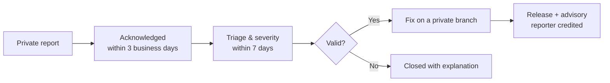

# Security Policy

## Supported versions

Clarion is pre-1.0 and ships from `main`. Only the latest commit on `main` receives security fixes.

| Version | Supported |
| :--- | :---: |
| `main` (latest) | ✅ |
| Older commits / forks | ❌ |

## Current attack surface

> [!NOTE]
> Clarion signs people in with **Firebase Authentication** and keeps each account's data **on the device** in its own SQLite file. Products come from a mock catalogue, there is no app backend or payments yet, and checkout is simulated.

In scope:

- **Authentication** (`lib/features/auth/`): email/password and Google sign-in, email verification, password reset, account deletion.
- **Per-account local data** (`lib/core/db/`): one SQLite file per account (`clarion_<uid>.db`), isolation between accounts on a shared device, and wiping on account deletion.
- **Notifications** (`lib/core/notifications/`): scheduled reminders and their payloads; clearing them on sign-out.
- **Intent parsing** (`lib/features/home/application/intent_controller.dart`): untrusted free-text input.
- **Firebase configuration** (`lib/firebase_options.dart`, `android/app/google-services.json`): these identify the project and are public by design. Access is enforced by Firebase Auth, not by hiding them.
- **Bundled assets** (`assets/`): supply-chain integrity of shipped files.
- **Dependencies** declared in `pubspec.yaml` / `pubspec.lock`.
- **Platform configuration** under `android/` and `web/`.
- Any future backend, sync, payment or network code.

## Reporting a vulnerability

> [!IMPORTANT]
> **Please do not open a public issue, discussion or pull request for security problems.**

Report privately through GitHub's private vulnerability reporting:

**➜ [Report a vulnerability](https://github.com/KrishKamra/Clarion/security/advisories/new)**

Please include:

1. A description of the issue and its impact.
2. Steps to reproduce, or a minimal proof of concept.
3. Affected commit, platform (Android / web) and Flutter version.
4. Any suggested fix or mitigation.

## What to expect

- Reports are handled by the project team listed in [`AUTHORS.md`](AUTHORS.md).
- You'll be kept informed throughout, and credited in the advisory unless you prefer otherwise.
- Please allow a fix to ship before disclosing publicly. We aim to resolve confirmed issues within 90 days.

## Safe harbour

Good-faith research that respects user privacy, avoids data destruction and service disruption, and follows this policy will not be pursued legally. Only test against your own builds and devices.
