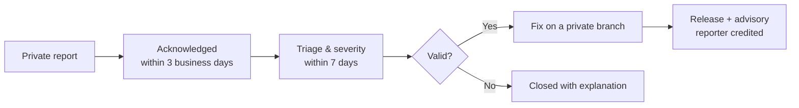

# Security Policy

## Supported versions

Clarion is pre-1.0 and ships from `main`. Only the latest commit on `main` receives security fixes.

| Version | Supported |
| :--- | :---: |
| `main` (latest) | ✅ |
| Older commits / forks | ❌ |

## Current attack surface

> [!NOTE]
> Clarion currently runs entirely on-device against an in-memory mock catalogue. There is **no backend, no network calls, no authentication, no payments and no persistent storage** yet. Checkout is simulated.

That keeps today's surface small, but the following areas are in scope and will grow as the roadmap lands:

- **Intent parsing** (`lib/features/home/application/intent_controller.dart`) — untrusted free-text input.
- **Bundled assets** (`assets/fonts/`) — supply-chain integrity of shipped files.
- **Dependencies** declared in `pubspec.yaml` / `pubspec.lock`.
- **Platform configuration** under `android/` and `web/`.
- Any future persistence, auth, payment or network code.

## Reporting a vulnerability

> [!IMPORTANT]
> **Please do not open a public issue, discussion or pull request for security problems.**

Report privately through GitHub's private vulnerability reporting:

**➜ [Report a vulnerability](https://github.com/KrishKamra/Clarion/security/advisories/new)**

Please include:

1. A description of the issue and its impact.
2. Steps to reproduce, or a minimal proof of concept.
3. Affected commit, platform (Android / web) and Flutter version.
4. Any suggested fix or mitigation.

## What to expect

- You'll be kept informed throughout, and credited in the advisory unless you prefer otherwise.
- Please allow a fix to ship before disclosing publicly. We aim to resolve confirmed issues within 90 days.

## Safe harbour

Good-faith research that respects user privacy, avoids data destruction and service disruption, and follows this policy will not be pursued legally. Only test against your own builds and devices.
