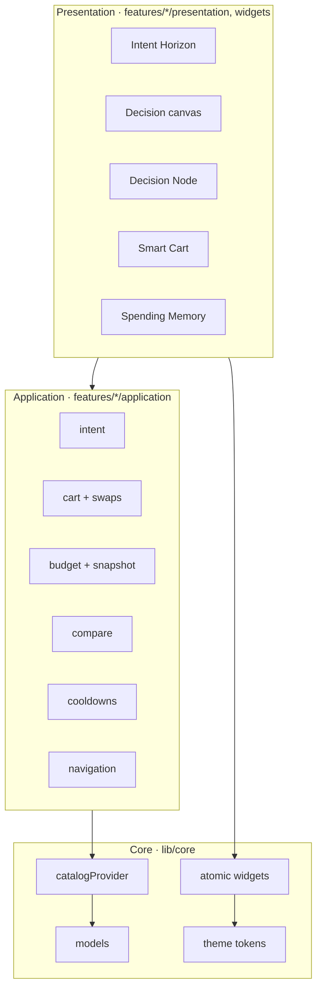
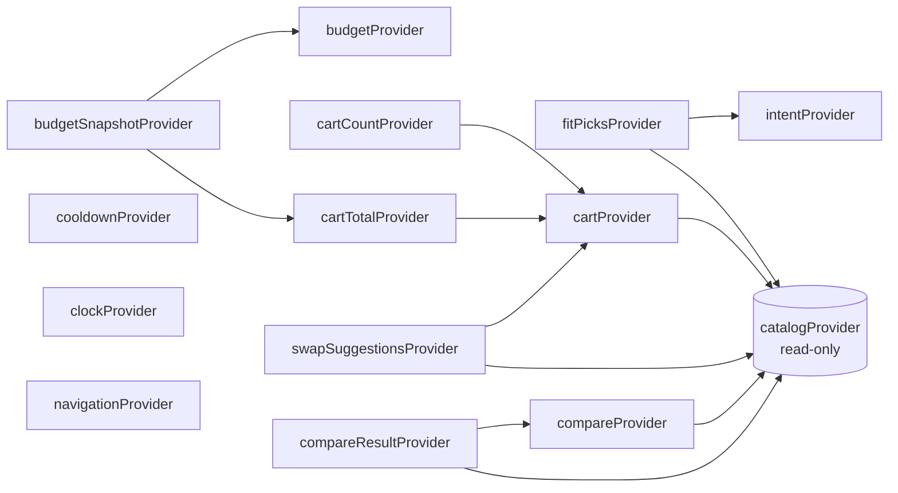
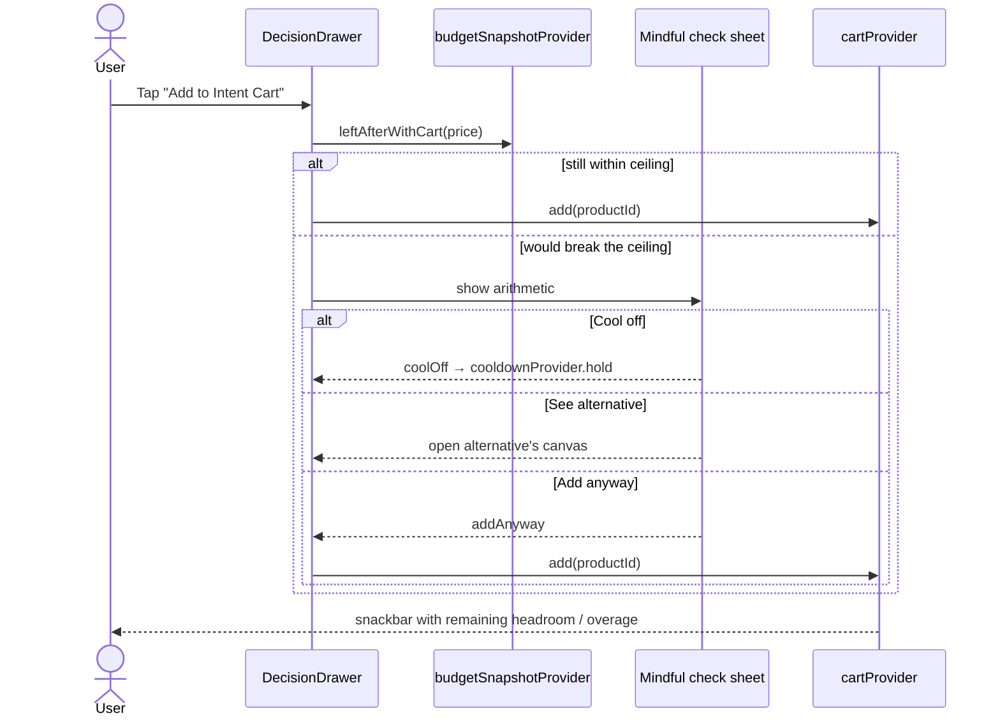
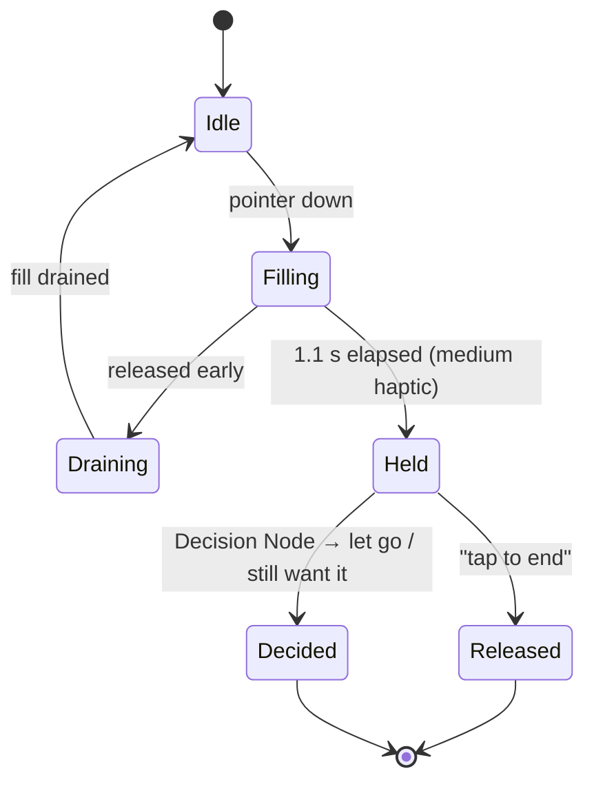

# Clarion Architecture

> [!NOTE]
> This describes the current, backend-free foundation. Everything reads products through `catalogProvider`, which is the single seam for a future repository/API.

## Layers

Feature-first. Shared, feature-agnostic code lives in `lib/core/`; each feature owns an `application/` layer (Riverpod state) and a `presentation/` or `widgets/` layer (UI).



```text
core/        theme · widgets · models · data (catalog + mock) · utils
features/
  navigation/  AppTab + MainScaffold shell (floating island)
  home/        Intent parsing & ranking → Intent Horizon
  decision/    Decision canvas, Decision Node, cooldowns, compare scoring
  cart/        CartController, Guardian Swap Engine → Smart Cart
  budget/      BudgetController + BudgetSnapshot, ceiling sheet
  memory/      Spending Memory (envelope, trend, categories)
```

## State (Riverpod 3)

Raw catalogue state is kept separate from volatile interaction state. Arrows point from a provider to what it watches.



| Provider | Kind | Responsibility |
| :--- | :--- | :--- |
| `catalogProvider` | `Provider<Catalog>` | Read-only products and compare pairs. |
| `navigationProvider` | `Notifier<AppTab>` | Active tab (`horizon`, `decisions`, `cart`, `memory`); any screen can redirect the shell. |
| `intentProvider` / `fitPicksProvider` | `Notifier` / derived | Parsed intent; ranked, budget-filtered Fit Stream. |
| `budgetProvider` | `Notifier<BudgetState>` | Ceiling, settled spend by category, mindful-win stats. |
| `cartProvider`, `cartTotalProvider`, `cartCountProvider` | `Notifier` / derived | Lines hold `Product`s; add / remove / restore / quantity / in-place swap. |
| `budgetSnapshotProvider` | derived | `committed`, `headroom`, `overBy`, `leftAfter`, `leftAfterWithCart`. |
| `swapSuggestionsProvider` | derived | Cheaper verified equivalents with spec parity, biggest saving first. |
| `cooldownProvider` / `clockProvider` | `Notifier<Map>` / `StreamProvider` | 24h cooling-off expiries; a 30 s tick for countdowns. |
| `compareProvider` / `compareResultProvider` | `Notifier` / derived | Selected pair + priorities → aligned rows, winners, weighted verdict. |

> [!TIP]
> Business rules (budget arithmetic, ranking, compare scoring, swaps) live in derived providers, so they're unit-testable with a bare `ProviderContainer` — see `test/widget_test.dart`.

## Key flows

### Add to Intent Cart (friction by design)



### 24h Cooling Off (`HoldButton`)



Screen-reader users trigger the hold through the button's semantic tap; a timed press isn't an accessible gesture.

## Budget semantics

- **Settled** = purchases this month. **Committed** = settled + cart (the header's `₹3,200 / ₹5,000`).
- The decision drawer leads with the item alone against the envelope (*"Leaves ₹801 safe buffer"*) and adds a second line when the current cart would push it past the ceiling.

> [!IMPORTANT]
> The add flow always checks the **cart-inclusive** figure (`leftAfterWithCart`). The headline is informational; the gate is the honest total.

## Rendering & performance

> [!WARNING]
> `BackdropFilter` must only appear inside `FrostedChrome`, and `FrostedChrome` must only be used for fixed chrome. A blur inside a scrolling list re-rasterises every frame and is the fastest way to drop below 60/120 fps.

| Rule | Where it's enforced |
| :--- | :--- |
| Blur only on fixed chrome (nav island, pinned headers, sheets, drawer, overlay buttons) | `core/widgets/frosted_chrome.dart` |
| List items are blur-free `TactileCard`s (fill + one stroked path) | `core/widgets/tactile_card.dart` |
| Pinned headers skip the frost entirely at scroll offset 0 | `core/widgets/chrome_header.dart` |
| Glows are radial gradients, never `MaskFilter` blurs | `AppDecorations.backlight` |
| Painters (dial, ring, band, grain) sit behind `RepaintBoundary`s | each painter widget |
| Canvas grain is generated once and cached; canvas wraps the `Scaffold` so the keyboard never resizes it | `core/widgets/obsidian_canvas.dart` |
| Tabs built lazily, kept alive, tickers paused when hidden | `features/navigation/main_scaffold.dart` |

## Data

`MockCatalog` provides 8 products whose fit factors sum exactly to their scores, deterministic 30-day price histories whose mean equals the stated average, local pickup points, and two compare pairs.

Seed state: ceiling ₹5,000, settled ₹2,000, cart ₹1,200 (lamp + cable kit). Adding the Atlas daypack breaches by ₹399; the Guardian's Metro swap saves ₹450 and lands ₹51 under.

## Testing

`test/widget_test.dart` covers formatting, intent parsing and budget filtering, fit-factor and catalogue integrity, seed budget arithmetic, the swap engine resolving a breach, and widget tests that render every tab, the decision canvas and the over-budget Guardian flow.

> [!NOTE]
> Widget tests use Flutter's wide test font, so any `RenderFlex` overflow fails the suite — a deliberate stress test for long labels and large text settings.
