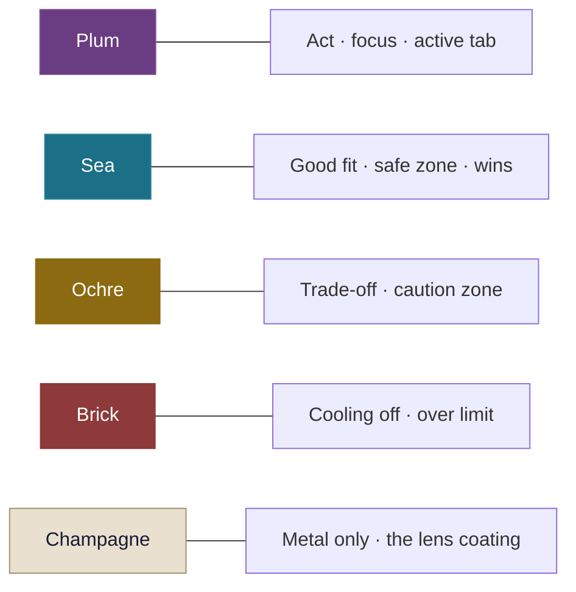
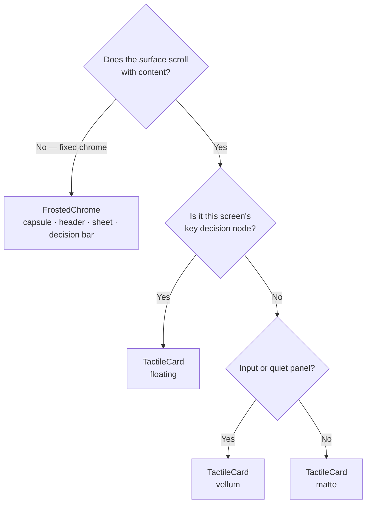

# Clarion Design System — Inkwell

Editorial restraint for a decision-support product: an ink canvas, two tiers of surface lit by a directional specular rim, and colour spent only where it carries meaning. Tokens live in `lib/core/theme/`; atoms in `lib/core/widgets/`.

> [!IMPORTANT]
> Feature code never uses raw hex values, font sizes or durations. Everything comes from `AppColors`, `AppTypography`, `AppDecorations`, `AppSpacing`, `AppRadii` and `AppMotion`.

## Principles

1. **Materiality over decoration.** Matte ink, a floating tier with a 0.5px edge, crisp specular rims and ambient halos behind the one decision node per screen — never glass on everything.
2. **Typography is the architecture.** Hierarchy comes from type, whitespace and hairlines, not boxes within boxes.
3. **Progressive disclosure.** Surface the fit score and the top two weighted factors first; specs and the full ledger open on intent (Miller's Law).
4. **One meaning per colour.** See the accent map.
5. **Friction where it helps.** Over-ceiling adds get a mindful check; cooling off needs a deliberate press-and-hold.
6. **Light lives on edges.** Colour sits on rims, the lens ring and the one action, never as fog drifting behind content.

## Colour (`app_colors.dart`)

Three ingredients and three meanings. Ink is the canvas and the type, navy-black like fountain-pen ink. Plum, the magenta of a real lens coating, is the one colour for acting. Champagne is the one metal. Sea, ochre and brick carry good, caution and over.

| Token | Dark | Light | Use |
| :--- | :--- | :--- | :--- |
| `canvas` | `#0A0C14` | `#EEF0F5` | The ink canvas (with film grain) |
| `surface` | `#11141F` | `#FFFFFF` | Card tier 1 (matte) + 3 % ambient wash |
| `surfaceHigh` | `#181C2A` | `#FFFFFF` | Card tier 2 (floating), sheets, snackbars |
| `edge` / `hairline` | white @ 8 % / 6 % | ink @ 12 % / 9 % | Tier-2 stroke; dividers and tracks |
| `vellum` / `vellumActive` | white @ 3 % / 5 % | white @ 70 % / 100 % | Inputs, quiet panels |
| `action` / `actionLit` | `#CFA6DC` / `#DDBDE8` | `#6A3C82` / `#7E4A97` | Plum: primary action, links, focus, the active tab |
| `onAction` | `#0A0C14` | `#FFFFFF` | Text on an accent fill: dark ink on light plum, white on deep plum |
| `champagne` | `#EAE0CF` | `#A39275` | The one metal: the lens coating's warm end. Decoration only, never a meaning |
| `good` / `goodLit` | `#7CC3CF` / `#9AD3DC` | `#1B6F86` / `#2A8299` | Sea: good fit, safe zone, criterion won |
| `caution` | `#D9BE70` | `#8C6A12` | Ochre: trade-offs, caution zone |
| `over` | `#DE8A84` | `#8E3A3A` | Brick: cooling off, over the limit |
| `textPrimary` / `textSecondary` / `textTertiary` | `#ECEEF5` / `#A8AEC2` / `#848BA1` | `#151B33` / `#4A5170` / `#5E6683` | Ink type, three tones |

Tokens are getters that resolve against `AppColors.brightness`, set by `ClarionApp` from the Appearance setting (System / Light / Dark, in Spending Profile); call sites never branch on the theme. Token names are roles, never hues, so a palette change never leaves a name that lies.

How the palette was chosen: candidates were scored on distance from Tailwind's stock shades (the look of AI-built UI), WCAG contrast in both themes, colour-blind separation of the three meanings, and clash between brand colours and meanings. Inkwell sits 10.4 ΔE (OKLab ×100) from the nearest stock shade, every text pair clears AA, and good, caution and over stay 9.6 apart under protanopia, deuteranopia and tritanopia; the previous palette scored 0.0 and 4.7. Good is sea rather than green for that reason, and brass became champagne because full brass sat 1.1 from the caution ochre.

### Accent map

| Helper | Rule |
| :--- | :--- |
| `AppColors.forFit(score)` | ≥ 85 sea · ≥ 70 plum · otherwise ochre |
| `AppColors.forBudgetRatio(ratio)` | > 1.0 brick · ≥ 0.85 ochre · otherwise sea — the same thresholds as the barometer's zones |

> [!NOTE]
> `textTertiary` is the quietest text tone but still clears 4.5:1 on the canvas in both themes. Use it only for micro labels, timestamps and inactive states — never for information a user must read to decide.

## Typography (`app_typography.dart`)

Three bundled OFL faces (`assets/fonts/`), no runtime download. All three include ₹ (U+20B9).

| Face | Job |
| :--- | :--- |
| **Newsreader** | The voice: screen and section titles, the goal prompt, hero figures. An editorial serif with optical sizes, so Clarion reads like a decision journal, not a storefront. Hindi falls back to **Tiro Devanagari Hindi**, so Hindi headings stay in a serif |
| **Schibsted Grotesk** | Everything a person reads and taps: body, labels, buttons. Also the "Clarion" logotype (`logotype`), which keeps the grotesque |
| **IBM Plex Mono** | Figures below hero size (prices in lists, scores, deltas) and uppercase micro labels. Fixed width, so counters never jitter |

| Token band | Style | Spec |
| :--- | :--- | :--- |
| Display / intent | `display`, `headline` | Newsreader 24–28px · 500 · −0.3 to −0.4 tracking |
| Section headers | `title` | Newsreader 19px · 500 · −0.1 tracking |
| Hero figures | `metricXL`, `metricLarge` | Newsreader 36 / 26px · 500 · tabular figures |
| Body / trade-offs | `body`, `bodySmall` | Schibsted 15 / 13.5px · 400 · 1.5 height (captions 12.5px) |
| Score & metric digits | `metric`, `metricSmall` | Plex Mono 12.5–15px · tabular |
| Micro labels | `overline` | Plex Mono 11px, uppercase, tracked — the floor for any text (chart and nav micro labels ≥ 10px) |

The rule for numbers: 24px and up is Newsreader, below that is Plex Mono.

## Materials (`app_decorations.dart`)

| Material | Recipe | Where |
| :--- | :--- | :--- |
| **Matte** (tier 1) | `surface` + 3 % top wash + specular rim | Default for content and anything in a list |
| **Floating** (tier 2) | `surfaceHigh` + top-left sheen + 0.5px `edge` + rim | The one surface per screen that should lift: the fit ledger, the barometer, the verdict |
| **Vellum** | `vellum` + soft rim | Intent field, empty states, quiet stats |
| **Optical glass** | `BackdropFilter` + `frostFill` + coating rim | Fixed spatial chrome only (`FrostedChrome`) |

- **Specular rim** (`RimLightPainter`): a hairline `LinearGradient` from top-left (white @ 15 %) to bottom-right (white @ 2 %) — light falls the same way on every surface.
- **Coating rim** (`AppDecorations.coatingRim`): on rounded glass only, the rim is the lens coating — plum where light enters at the top-left, a champagne glint, clear glass, a trace of plum at the far corner. Full-bleed chrome such as pinned headers keeps the plain rim.
- **Ambient halo** (`AppDecorations.backlight`): a radial gradient — never a blur — behind fit gauges, the budget ring, the score total and the active nav pill.
- **Tactile fill**: primary buttons use a restrained plum diagonal (`actionLit` → `action`), lit from the same top-left as the rims. Gradients are lighting, never loud surface fills.
- **Arrival light** (`AuroraBackdrop`, sign-in): one still pool of plum and champagne falling from above, for the frosted pane to refract. Nothing drifts.

> [!WARNING]
> Never put `BackdropFilter`, `MaskFilter.blur` or coloured drop shadows on anything inside a scroll view. Blur is for fixed chrome; glow is a gradient.

## Spacing, radii, motion, haptics (`app_spacing.dart`)

| Group | Values |
| :--- | :--- |
| Spacing | 4px grid: `xs 4 · sm 8 · md 12 · lg 16 · xl 20 · xxl 24 · xxxl 32 · section 40`; gutter 20 |
| Radii | `xs 6 · sm 10 · md 14 · lg 18 · xl 24 · pill` |
| Motion | `fast 220 · medium 250 · slow 280 ms` on `easeOutCubic`; `reveal 640 ms` only for one-off data draws (gauge sweep, price band); `arrival 1400 ms` and `aperture 700 ms` only for the cold-start splash, once per launch |
| Haptics | Only through `AppHaptics` (`lib/core/feedback/`), five words with one meaning each: `select` (stepping through choices: pills, tabs, chart and slider notches, the start of a hold), `tap` (buttons and tappable surfaces), `commit` (a decision that changes state: add to cart, a hold set, a goal saved, a long press), `success` (an order placed: light then firm, a settling), `warn` (a failed sign-in, an add that would break the ceiling: two even knocks). No haptics for browsing, scrolling or opening things |
| Hover & glow | Every tappable surface goes through `Pressable`: a click cursor, a hover lift of 60 % of the press depth, and hover/press state exposed through `Pressable.stateOf`. `PressGlow` turns that state into light: solid buttons keep a faint glow of their own colour that blooms on hover, and tappable `TactileCard`s light their rim in their tint (plum by default) with a soft halo. Glows are box shadows, never blurs |
| Reduced motion | Ambient loops (the lockup breath) and entrances stop when `MediaQuery.disableAnimations` is set; the splash shows its settled lockup and fades |

> [!CAUTION]
> No elastic, bounce or overshoot curves. If a transition needs more than 280 ms to read, the layout change is too big.

## Atoms (`lib/core/widgets/`)

| Widget | Role |
| :--- | :--- |
| `TactileCard` | Matte / floating / vellum surface with specular rim, optional tint, press feedback and a lit rim on hover |
| `AuroraBackdrop` | The arrival canvas: one still light of plum and champagne from above, under frosted glass; gradients only |
| `FitScoreGauge` | `CustomPainter` 300° utility dial (0–100%), mono score, halo + ticks on large sizes |
| `IntentField` | Conversational intent input, prompt set in Newsreader, with a plum focus filament and one scrolling row of suggestions |
| `DynamicPill` | One micro-badge for categories, tags, trade-offs and selectable choices |
| `FloatingNavCapsule` | Optical-glass capsule with sentence-case sans labels (mono caps stay for eyebrows); magnetic active pill with plum halo; count badges and status dots |
| `HoldButton` | Press-and-hold confirm with sweep fill, micro-progress ring and live timer |
| `PriceBandChart` | Interactive 30-day band: scrub to read any day's price against today |
| `ClarionButton` | `primary` (plum gradient) · `secondary` (vellum) · `positive` (sea gradient) |
| `FrostedChrome` | The only `BackdropFilter` owner; wears the coating rim when rounded |
| `ProductArtwork` | Matte studio stage with tone-tinted key light and floor shadow |
| `ObsidianCanvas` | The ink canvas + single ambient pool + cached film grain |
| `ChromeSliverHeader` / `ScreenTitle` | Pinned header that frosts only once content scrolls under it |
| `ClarionSplash` | Cold-start arrival (`lib/features/splash/`): converging focus rings lock onto the lens, the name tracks in, a plum-to-champagne filament reports real boot progress, then the lens ring opens as an aperture onto the app |
| `ClarionSheet`, `RoundIconButton`, `SectionHeader`, `ProgressRing`, `AnimatedMetric`, `ClarionWordmark`, `Pressable` | Supporting primitives |

## Brand mark

`assets/brand/clarion_logo.svg` is the single source: a lens ring (champagne where the light catches it at the top-left, deepening into plum) with an off-centre focal point, "what you are actually looking for". The focal point is matte plum, never glossy, and the mark carries no specular glint, so it reads as precision optics at 16dp as well as 1024. Launcher, adaptive, themed (monochrome) and splash PNGs in `assets/brand/icon/` are rendered from it at fixed ring proportions (adaptive foreground 55 %, legacy icon 62 %, splash 44 %, Android 12 splash 51.5 %) over an ink background with one soft plum light from the top-left, then `dart run flutter_launcher_icons` and `dart run flutter_native_splash:create`. The README banner (`clarion_banner.svg`, `clarion_banner_light.svg`) has one motion, the same as the splash: focus rings lock onto the lens and a glint runs once round the ring. The canvas never moves. CSS only, still under reduced motion.

## Voice

Inform, never pressure: no countdown deals, no scarcity, no confirm-shaming. *"No rush — Clarion keeps watching."* The recommended path is the primary action; the user always keeps the final say ("Add anyway", "Proceed anyway").
