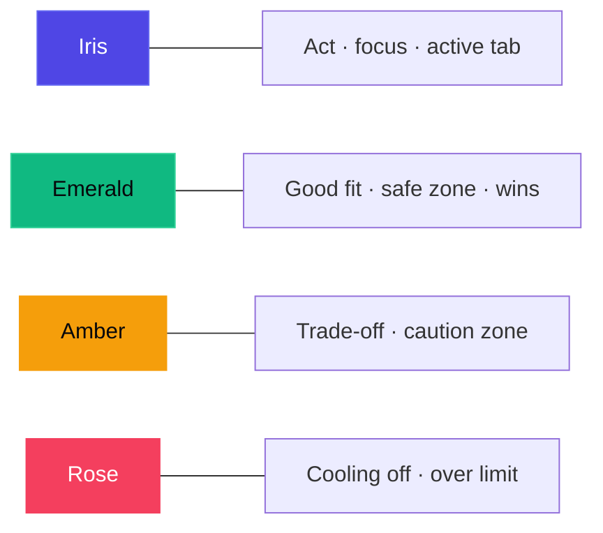
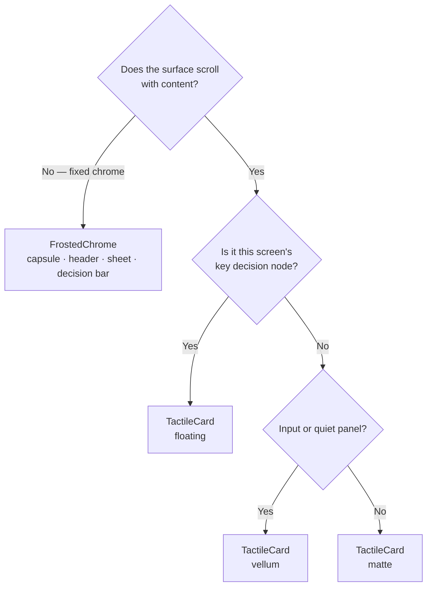

# Clarion Design System — Obsidian Titanium & Botanical Emerald

Editorial restraint for a decision-support product: a matte obsidian canvas, two tiers of surface lit by a directional specular rim, and colour spent only where it carries meaning. Tokens live in `lib/core/theme/`; atoms in `lib/core/widgets/`.

> [!IMPORTANT]
> Feature code never uses raw hex values, font sizes or durations. Everything comes from `AppColors`, `AppTypography`, `AppDecorations`, `AppSpacing`, `AppRadii` and `AppMotion`.

## Principles

1. **Materiality over decoration.** Matte slate, a floating tier with a 0.5px edge, crisp specular rims and ambient halos behind the one decision node per screen — never glass on everything.
2. **Typography is the architecture.** Hierarchy comes from type, whitespace and hairlines, not boxes within boxes.
3. **Progressive disclosure.** Surface the fit score and the top two weighted factors first; specs and the full ledger open on intent (Miller's Law).
4. **One meaning per colour.** See the accent map.
5. **Friction where it helps.** Over-ceiling adds get a mindful check; cooling off needs a deliberate press-and-hold.

## Colour (`app_colors.dart`)

| Token | Value | Use |
| :--- | :--- | :--- |
| `canvas` | `#07080B` | Base Void — pure obsidian slate, no blue cast (with film grain) |
| `surface` | `#0E1017` | Card tier 1 (matte) + 3 % ambient wash |
| `surfaceHigh` | `#141824` | Card tier 2 (floating) + specular sheen, sheets, snackbars |
| `edge` | white @ 8 % | 0.5px stroke on tier-2 surfaces |
| `vellum` / `vellumActive` | white @ 3 % / 5 % | Inputs, quiet panels |
| `hairline` | white @ 6 % | Dividers, tracks |
| `iris` / `irisGlow` | `#4F46E5` / `#6366F1` | Precision decision anchor: primary action, focus, active tab |
| `emerald` / `emeraldGlow` | `#10B981` / `#34D399` | Good decision: optimal fit, safe zone, criterion won |
| `amber` | `#F59E0B` | Constructive pause: trade-offs, caution zone |
| `rose` | `#F43F5E` | Anti-impulse friction: cooling off, over the limit |
| `textPrimary` / `textSecondary` / `textTertiary` | `#F8FAFC` / `#A3B0C2` / `#7D8899` | Titanium / Slate Silver / Muted Slate |

The values above are the dark palette. Every token also has a **Porcelain** light value (canvas `#F3F4F6`, white cards with an ink rim and soft contact shadow, text `#0B0F19` / `#475569` / `#5B6678`, accents deepened to emerald `#047857`, amber `#B45309`, rose `#E11D48`, iris `#4F46E5` so text set in them clears WCAG AA on white). Tokens are getters that resolve against `AppColors.brightness`, set by `ClarionApp` from the Appearance setting (System / Light / Dark, in Spending Profile); call sites never branch on the theme.

### Accent map

| Helper | Rule |
| :--- | :--- |
| `AppColors.forFit(score)` | ≥ 85 emerald · ≥ 70 iris · otherwise amber |
| `AppColors.forBudgetRatio(ratio)` | > 1.0 rose · ≥ 0.85 amber · otherwise emerald — the same thresholds as the barometer's zones |

> [!NOTE]
> `textTertiary` is the quietest text tone but still clears 4.5:1 on the canvas in both themes. Use it only for micro labels, timestamps and inactive states — never for information a user must read to decide.

## Typography (`app_typography.dart`)

Two bundled OFL faces (`assets/fonts/`), no runtime download. Both include ₹ (U+20B9) and a true minus (U+2212).

| Token band | Style | Spec |
| :--- | :--- | :--- |
| Display / intent | `display`, `headline` | 24–28px · 600 · −0.6 tracking |
| Section headers | `title` | 18px · 600 · −0.3 tracking |
| Body / trade-offs | `body`, `bodySmall` | 15 / 13.5px · 400 · 0 tracking · 1.5 height (captions 12.5px) |
| Score & metric digits | `metric*` | 12–16px (34 for hero figures) · mono, tabular |
| Micro labels | `overline` | 11px mono, uppercase, tracked — the floor for any text (chart and nav micro labels ≥ 10px) |

> [!TIP]
> The brief suggests Inter/SF Pro; Clarion uses **Schibsted Grotesk** instead — equally legible at UI sizes, but with sharper terminals that give the product its own voice. **Geist Mono** carries every number a user compares, so animated counters never jitter.

## Materials (`app_decorations.dart`)

| Material | Recipe | Where |
| :--- | :--- | :--- |
| **Matte** (tier 1) | `#0E1017` + 3 % top wash + specular rim | Default for content and anything in a list |
| **Floating** (tier 2) | `#141824` + top-left sheen + 0.5px `edge` + rim | The one surface per screen that should lift: the fit ledger, the barometer, the verdict |
| **Vellum** | white @ 3 % + soft rim | Intent field, empty states, quiet stats |
| **Frost** | `BackdropFilter` + `frostFill` + rim | Fixed spatial chrome only (`FrostedChrome`) |

- **Specular rim** (`RimLightPainter`): a hairline `LinearGradient` from top-left (white @ 15 %) to bottom-right (white @ 2 %) — light falls the same way on every surface.
- **Ambient halo** (`AppDecorations.backlight`): a radial gradient — never a blur — behind fit gauges, the budget ring, the score total and the active nav pill.
- **Tactile fill**: primary buttons use a restrained iris diagonal (`#6366F1` → `#4F46E5`), lit from the same top-left as the rims. Gradients are lighting, never loud surface fills.

> [!WARNING]
> Never put `BackdropFilter`, `MaskFilter.blur` or coloured drop shadows on anything inside a scroll view. Blur is for fixed chrome; glow is a gradient.

## Spacing, radii, motion, haptics (`app_spacing.dart`)

| Group | Values |
| :--- | :--- |
| Spacing | 4px grid: `xs 4 · sm 8 · md 12 · lg 16 · xl 20 · xxl 24 · xxxl 32 · section 40`; gutter 20 |
| Radii | `xs 6 · sm 10 · md 14 · lg 18 · xl 24 · pill` |
| Motion | `fast 220 · medium 250 · slow 280 ms` on `easeOutCubic`; `reveal 640 ms` only for one-off data draws (gauge sweep, price band) |
| Haptics | `selectionClick` on intent pills, tab switches, chart/barometer scrubbing and the start of a hold; `mediumImpact` when a 24h cooling-off hold commits; `lightImpact` on card and button taps |

> [!CAUTION]
> No elastic, bounce or overshoot curves. If a transition needs more than 280 ms to read, the layout change is too big.

## Atoms (`lib/core/widgets/`)

| Widget | Role |
| :--- | :--- |
| `TactileCard` | Matte / floating / vellum surface with specular rim, optional tint and press feedback |
| `FitScoreGauge` | `CustomPainter` 300° utility dial (0–100%), mono score, halo + ticks on large sizes |
| `IntentField` | Conversational intent input with an iris focus filament and contextual pills |
| `DynamicPill` | One micro-badge for categories, tags, trade-offs and selectable choices |
| `FloatingNavCapsule` | Frosted spatial capsule; magnetic active pill with iris halo; count badges and status dots |
| `HoldButton` | Press-and-hold confirm with sweep fill, micro-progress ring and live timer |
| `PriceBandChart` | Interactive 30-day band: scrub to read any day's price against today |
| `ClarionButton` | `primary` (iris gradient) · `secondary` (vellum) · `positive` (emerald gradient) |
| `FrostedChrome` | The only `BackdropFilter` owner |
| `ProductArtwork` | Matte studio stage with tone-tinted key light and floor shadow |
| `ObsidianCanvas` | Canvas + single ambient pool + cached film grain |
| `ChromeSliverHeader` / `ScreenTitle` | Pinned header that frosts only once content scrolls under it |
| `ClarionSheet`, `RoundIconButton`, `SectionHeader`, `ProgressRing`, `AnimatedMetric`, `ClarionWordmark`, `Pressable` | Supporting primitives |

## Voice

Inform, never pressure: no countdown deals, no scarcity, no confirm-shaming. *"No rush — Clarion keeps watching."* The recommended path is the primary action; the user always keeps the final say ("Add anyway", "Proceed anyway").
