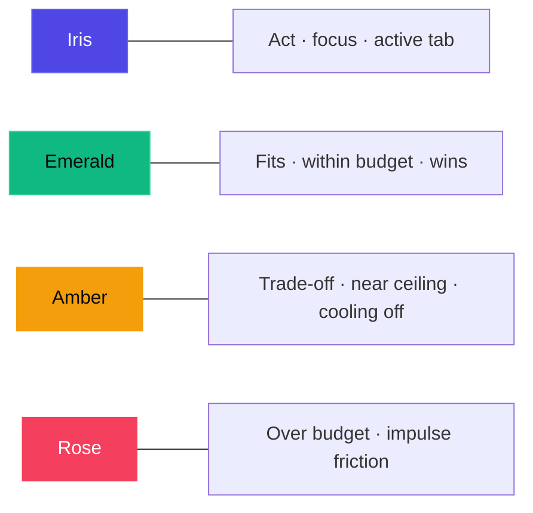
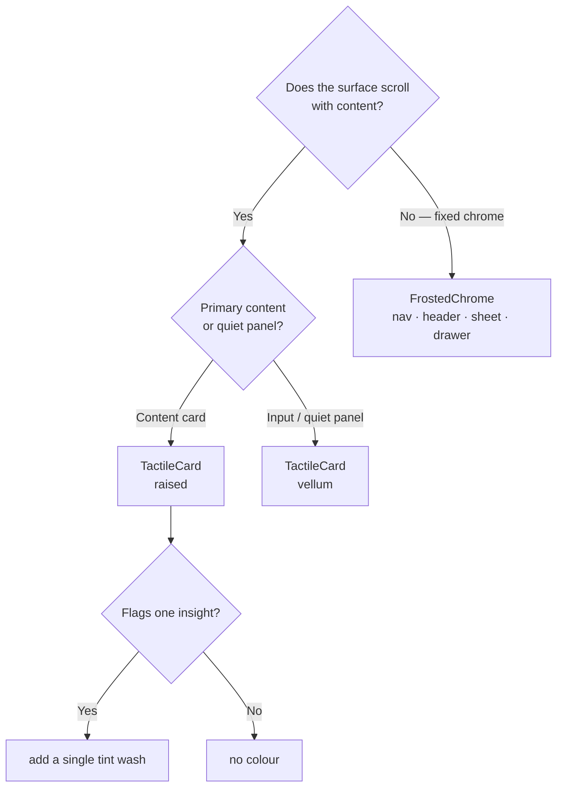

# Clarion Design System — Midnight Obsidian & Ethereal Mint

Editorial quiet luxury: a matte obsidian canvas, surfaces that read as stacked vellum, and colour spent only where it carries meaning. Tokens live in `lib/core/theme/`; atoms in `lib/core/widgets/`.

> [!IMPORTANT]
> Feature code never uses raw hex values, font sizes or durations. Everything comes from `AppColors`, `AppTypography`, `AppDecorations`, `AppSpacing`, `AppRadii` and `AppMotion`.

## Principles

1. **Calm over clutter.** Hierarchy comes from type, whitespace and hairline rules — not boxes within boxes.
2. **One meaning per colour.** See the accent map below.
3. **Show the arithmetic.** Scores are ledgers, budget impact is a number, swaps state their saving and spec parity.
4. **Friction where it helps.** Over-ceiling adds get a mindful check; cooling off requires a deliberate press-and-hold.

## Colour (`app_colors.dart`)

| Token | Value | Use |
| :--- | :--- | :--- |
| `canvas` | `#08090C` | Obsidian Deep — app canvas (with film grain) |
| `surface` | `#0F1117` | Raised cards (+4 % luminance wash) |
| `surfaceHigh` | `#151821` | Sheets, snackbars |
| `vellum` / `vellumActive` | white @ 3 % / 5 % | Inputs, quiet panels |
| `rim` / `rimBright` | white @ 9 % / 12 % | Directional top-edge highlight |
| `hairline` | white @ 6 % | Dividers, tracks |
| `iris` / `irisGlow` | `#4F46E5` / `#6366F1` | Primary action, focus, active tab |
| `emerald` / `emeraldGlow` | `#10B981` / `#34D399` | Optimal fit, within budget, criterion won |
| `amber` | `#F59E0B` | Trade-offs, approaching ceiling, cooling off |
| `rose` | `#F43F5E` | Anti-impulse friction, over budget |
| `textPrimary` / `textSecondary` / `textTertiary` | `#F8FAFC` / `#94A3B8` / `#475569` | Titanium / Slate / Muted Slate |

### Accent map

Two helpers keep these decisions in one place:

| Helper | Rule |
| :--- | :--- |
| `AppColors.forFit(score)` | ≥ 85 emerald · ≥ 70 iris · otherwise amber |
| `AppColors.forBudgetRatio(ratio)` | > 1.0 rose · ≥ 0.85 amber · otherwise emerald |

> [!NOTE]
> `textTertiary` (`#475569`) is intentionally dim on the canvas. Use it only for micro labels and inactive states — never for information a user must read to decide.

## Typography (`app_typography.dart`)

Two bundled OFL faces (`assets/fonts/`), no runtime download. Both include ₹ (U+20B9) and a true minus (U+2212).

| Face | Job | Styles |
| :--- | :--- | :--- |
| **Schibsted Grotesk** | Reading | `display 28/600/−0.6` · `headline 24/600/−0.6` · `title 18` · `titleSmall 15.5` · `body 15/1.5` · `bodySmall 13.5/1.45` · `label 13.5/500` · `caption 12` |
| **Geist Mono** | Comparing | `metricXL 34` · `metricLarge 24` · `metric 15` · `metricSmall 12` · `overline 10.5` (uppercase, tracked) |

> [!TIP]
> Any number a user compares — price, score, delta, count, countdown — uses a `metric*` style. Fixed advances mean animated counters never shift the layout.

## Materials (`app_decorations.dart`)

| Material | Recipe | Where |
| :--- | :--- | :--- |
| **Raised** | `#0F1117` + 4 % top wash + rim light | Anything in a list (`TactileCard`) |
| **Vellum** | white @ 3 % + soft rim | Intent input, quiet panels, empty states |
| **Frost** | `BackdropFilter` blur + `frostFill` + rim | Fixed chrome only (`FrostedChrome`) |

- `RimLightPainter` strokes a 1px vertical gradient: bright top edge, nearly invisible bottom.
- `AppDecorations.backlight` is a radial gradient — never a blur — behind fit dials, the budget ring and the score total.

> [!WARNING]
> Never put `BackdropFilter`, `MaskFilter.blur` or coloured drop shadows on anything inside a scroll view. Blur is for fixed chrome; glow is a gradient.

## Spacing, radii, motion (`app_spacing.dart`)

| Group | Values |
| :--- | :--- |
| Spacing | 4px scale: `xs 4 · sm 8 · md 12 · lg 16 · xl 20 · xxl 24 · xxxl 32 · section 40`; gutter 20 |
| Radii | `xs 6 · sm 10 · md 14 · lg 18 · xl 24 · pill` |
| Motion | `fast 200 · medium 240 · slow 280 ms` on `easeOutCubic` / `fastOutSlowIn`; `reveal 640 ms` only for one-off data draws (dial sweep, price band) |
| Haptics | `lightImpact` on every `Pressable` commit (cards, tabs, buttons) and intent submission; `selectionClick` when a hold begins; `mediumImpact` when it completes |

> [!CAUTION]
> No elastic, bounce or overshoot curves. If a transition needs more than 280 ms to read, the layout change is too big.

## Atoms (`lib/core/widgets/`)

| Widget | Role |
| :--- | :--- |
| `TactileCard` | Raised/vellum card with rim light, optional tint and press feedback |
| `FrostedChrome` | The only `BackdropFilter` owner |
| `FitDial` | 300° instrument gauge, mono score; backlight + ticks on large sizes |
| `IntentInput` / `IntentCapsule` | Intent Canvas (24px display type) with iris focus filament; curated capsules |
| `FloatingNavBar` | Frosted island with a magnetic (stretch-in-flight) indicator |
| `HoldButton` | Press-and-hold confirm; semantic tap for screen readers |
| `ClarionButton` | `primary` (iris) · `secondary` (vellum) · `positive` (emerald) |
| `PriceBandChart` | 30-day low–high band, dashed average, series ending in today |
| `ProductArtwork` | Matte studio stage with tone-tinted key light and floor shadow |
| `ObsidianCanvas` | Canvas + single ambient pool + cached film grain |
| `ChromeSliverHeader` / `ScreenTitle` | Pinned header that frosts only once content scrolls under it |
| `ClarionSheet`, `RoundIconButton`, `SectionHeader` / `MetaTag`, `ProgressRing`, `AnimatedMetric`, `ClarionWordmark`, `Pressable` | Supporting primitives |

## Voice

Inform, never pressure: no countdown deals, no scarcity, no confirm-shaming. *"No rush — Clarion keeps watching."* The recommended path is the primary action; the user always keeps the final say ("Add anyway", "Proceed anyway").
